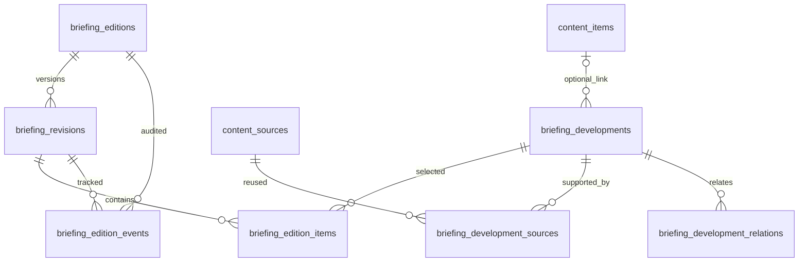

# SAS Daily Briefing V1 — Package 1
## Data Model & Security Design

**الحالة:** تصميم تنفيذي ومسودة SQL للمراجعة؛ لم تُطبّق Migration على Supabase البعيد.  
**الفرع:** `feat/daily-briefing-data-model-security-v1`  
**المرجع:** PR #31 / فرع `feat/daily-briefing-experience-v1`  
**التاريخ:** 12 نوفمبر 2026

## 1. قرار الحزمة

تعتمد الحزمة نموذجًا يفصل بين:
- **العدد**: هوية إصدار ثابتة ورابط دائم.
- **النسخة التحريرية**: حالة المحتوى في لحظة مراجعة/اعتماد/نشر.
- **التطور**: سجل معلوماتي مستقل قابل لإعادة الاستخدام.
- **المصدر**: سجل مشترك في `public.content_sources`.
- **عنصر العدد**: اختيار تطور داخل نسخة محددة مع ترتيبه وتأطيره التحريري.

كل تصحيح بعد النشر ينشئ نسخة جديدة. لا يُعدّل المحتوى المنشور ولا لقطة مصادره بأثر رجعي.

## 2. ما تحقق من قاعدة البيانات الحالية

المشروع: `budsfbyrdpjkobqstpyr`، PostgreSQL 17.11.0.018، منطقة Sydney.

الجداول المعاد استخدامها:
- `public.content_sources`: 12 سجلًا وقت الفحص.
- `public.content_source_links`: علاقة المصادر بالمواد التحريرية.
- `public.content_items`: المواد التحريرية المنشورة والمسودات.
- `public.user_roles`: أدوار `admin/editor/author`.

حقول `content_sources` الحالية تشمل `source_type`, `source_name`, `organization_name`, `source_url`, `source_reference`, `publication_date`, `attribution_note`, `is_active`, وبيانات الإنشاء والتحديث. لا نغير معنى `publication_date date`.

الدالة القائمة `private.has_any_role(required_roles text[])`:
- `SECURITY DEFINER` مع `search_path = ''`.
- تتحقق من `auth.uid()` ومن `is_active = true`.
- متاحة للدور `authenticated`.
- مخطط `private` له USAGE للمستخدم المسجل وليس لـ `anon`.

وجدنا مستخدمًا إداريًا نشطًا واحدًا، ولم نجد أدوار تحرير نشطة وقت الفحص. يجب إنشاء/تفعيل محرر قبل اختبار مسار المحرر، عبر مسار إدارة الأدوار المعتمد وليس عبر بيانات اختبار داخل الإنتاج.

## 3. ERD



## 4. قاموس الكيانات

### `briefing_editions` — هوية العدد
- `id`: UUID.
- `edition_no`: رقم تسلسلي فريد.
- `slug`: رابط دائم فريد.
- `edition_date`, `edition_type`: تاريخ العدد ونوعه (daily/special).
- `status`: active / archived / withdrawn.
- `current_revision_id`: مؤشر النسخة المنشورة الحالية.
- `created_by`, `created_at`, `updated_at`.

قيد فريد جزئي يمنع تكرار العدد اليومي في التاريخ نفسه، مع السماح بإصدارات خاصة.

### `briefing_revisions` — النسخ التحريرية
- `edition_id`, `revision_no`, `revision_kind`: initial/correction.
- `based_on_revision_id`: النسخة المنشورة التي بُني عليها التصحيح.
- `status`: draft / in_review / approved / published.
- `title_ar`, `analysis_ar`, `methodology_ar`, `coverage_note_ar`.
- `window_start`, `window_end`, `checked_at`.
- بيانات الإرسال والمراجعة والاعتماد والنشر.
- `published_snapshot jsonb`: لقطة المحتوى والمصادر وقت النشر.

قيد فريد جزئي يسمح بنسخة initial واحدة لكل عدد. النسخة المنشورة غير قابلة للتعديل؛ التصحيح ينشئ Revision مستقلة.

### `briefing_developments` — سجل التطورات
- العنوان والملخص والتصنيف الموضوعي والجغرافي.
- `information_class`: fact / position / claim / analysis.
- `verification_status`: verified / attributed / disputed / unverified / not_applicable.
- `occurred_at`, `occurred_on`, `time_precision`.
- `related_content_item_id`: ارتباط اختياري بمادة منشورة.
- `status`: draft / ready / archived.

الفصل الدلالي إلزامي: تصنيف المعلومة لا يساوي درجة التحقق منها. ووقت وقوع التطور لا يساوي وقت نشر المصدر.

### `briefing_development_sources` — إسناد التطور
- `development_id`, `source_id`.
- `source_role`: primary / supporting / context.
- `display_publicly boolean default false`: مصدر داخلي افتراضيًا، ولا يظهر في النسخة العامة إلا باختيار تحريري صريح.
- `source_excerpt`, `attribution_note`, `accessed_at`, `display_order`.
- علاقة many-to-many بمفتاح مركب يمنع تكرار المصدر داخل التطور.

### `briefing_edition_items` — عناصر العدد
- `revision_id`, `development_id`.
- `display_section`: executive_summary / developments.
- `display_order`.
- `summary_text_ar`, `headline_override_ar`, `what_changed_ar`, `why_it_matters_ar`, `context_ar`.

يمكن إعادة استخدام التطور في أكثر من عدد، مع ترتيب وسياق تحريري مختلف لكل نسخة.

### `briefing_development_relations` — الروابط السياقية
العلاقات: updates / supersedes / contradicts / related_to. لا تنشئ هذه الحزمة نظام القضايا والأحداث الكامل.

### `briefing_edition_events` — سجل التدقيق
يسجل الإنشاء، والإرسال للمراجعة، والإعادة، والاعتماد، والنشر، وإنشاء التصحيح، والأرشفة والسحب. لا تمنح أدوار التطبيق صلاحيات INSERT/UPDATE/DELETE عليه؛ الكتابة تتم عبر triggers داخلية.

## 5. توسيع مكتبة المصادر

تضاف ثلاثة حقول فقط إلى `content_sources`:
- `source_title text`: عنوان الوثيقة أو المادة الأصلية.
- `published_at timestamptz`: وقت النشر الدقيق.
- `language_code text`: لغة المصدر.

يبقى `source_name` اسم الجهة/الناشر، و`organization_name` المؤسسة، و`publication_date` تاريخًا فقط. لا ننشئ مكتبة مصادر ثانية.

## 6. دورة الحالات

```text
draft -> in_review -> approved -> published
              |
              +-> draft (إعادة للمحرر بملاحظة إلزامية)

published --(correction request)--> new draft revision
```

- المحرر ينشئ ويحرر المسودة ويرسلها للمراجعة.
- المدير يعيدها أو يعتمدها أو ينشرها.
- لا ينتقل أي سجل إلى published إلا عبر RPC النشر.
- نشر النسخة وتحديث مؤشر العدد يتمان داخل معاملة واحدة.
- أرشفة العدد لا تحذف النسخ؛ والسحب يجعل العدد غير متاح للعامة.
- لا يُسمح بإعادة تفعيل العدد المسحوب.

## 7. مصفوفة الصلاحيات

| العملية | admin | editor | author | anon |
|---|---:|---:|---:|---:|
| قراءة بيانات التحرير الداخلية | نعم | نعم | لا | لا |
| إنشاء/تحرير مسودة | نعم | نعم | لا | لا |
| إرسال للمراجعة | نعم | نعم | لا | لا |
| إعادة للمحرر | نعم | لا | لا | لا |
| اعتماد ونشر | نعم | لا | لا | لا |
| إنشاء مسودة تصحيح | نعم | نعم | لا | لا |
| أرشفة/سحب العدد | نعم | لا | لا | لا |
| قراءة النسخة المنشورة والأرشيف | نعم | نعم | لا | عبر RPC فقط |

لا نوسع `requireAdmin` أو `AdminLayout` العام. غرفة الإحاطة تحتاج حارس صلاحيات مستقلًا لاحقًا.

## 8. نموذج الأمان

1. RLS مفعّل على الجداول السبعة الجديدة.
2. لا توجد صلاحيات مباشرة لـ `anon` على جداول الإحاطة.
3. `authenticated` يحصل على أقل صلاحيات DML اللازمة، وسجل التدقيق SELECT فقط.
4. كل سياسة داخلية تتحقق من `private.has_any_role`، وليس من مجرد كون المستخدم authenticated.
5. دوال دورة العمل `SECURITY INVOKER`؛ تظل RLS فعالة.
6. دالتا القراءة العامة فقط `SECURITY DEFINER`، مع `search_path = ''` ومراجع مؤهلة بالكامل، وإرجاع Snapshot منشور فقط.
7. تسحب EXECUTE من PUBLIC صراحة، ثم تمنح القراءة العامة لـ anon/authenticated، ودوال التحرير لـ authenticated فقط.
9. دوال triggers الخاصة لا تُتاح للتنفيذ المباشر من أدوار API.
10. التصحيح لا يغيّر Snapshot منشورًا سابقًا.
11. لا تغييرات على امتيازات الجداول الأساسية القائمة (`content_items`, `content_sources`, `content_source_links`, `user_roles`) ضمن هذه الحزمة؛ نطاقها يقتصر على جداول الإحاطة وإضافة حقول وصفية للمصادر.

**ملاحظة Advisor:** قد يظهر تحذير SECURITY DEFINER على دالتي القراءة العامتين؛ هذا تعريض مقصود ومحدود لواجهتي قراءة فقط. يجب مراجعة نص التحذير بعد الاختبار المحلي وعدم تجاهل أي دوال أخرى تظهر.

## 9. بوابة النشر داخل قاعدة البيانات

يمنع النشر ما لم تتحقق الشروط:
- قراءة رئيسية بين 400 و650 كلمة.
- موجز تنفيذي من 3 إلى 5 نقاط.
- كل نقطة في الموجز مرتبطة بتطور موجود في سجل التطورات.
- وجود تطور واحد على الأقل في السجل.
- جميع التطورات المختارة في حالة ready.
- لكل تطور مصدر واحد على الأقل يملك URL أو source_reference.
- نافذة التغطية صالحة ووقت آخر تحقق محفوظ.

حد الكلمات معيار نشر، بينما تعرض الواجهة لاحقًا عدادًا استباقيًا للمحرر.

## 10. نقاط المراجعة قبل الدمج

- مسودة SQL موجودة في `docs/sql/daily_briefing_package1.draft.sql` وليست Migration قابلة للتطبيق بعد.
- يجب توليد اسم Migration من CLI محليًا عبر `supabase migration new daily_briefing_package1` ثم نقل محتوى المسودة إلى الملف الناتج.
- لم تُشغّل قاعدة PostgreSQL محلية في بيئة الوكيل؛ لم يتم الادعاء باجتياز parser أو migration reset.
- لا Migration مطبقة على Supabase البعيد.
- لا بيانات تجريبية أو أخبار وهمية أُدخلت إلى قاعدة البيانات.
- لا تعديل على Vercel أو main أو PR #30/#31.

## 11. التحقق المحلي على Windows

نفّذ بعد سحب فرع الحزمة ومراجعة SQL:

```powershell
cd C:\SAS-PLATFORM-DEV
git status --short --branch
git fetch origin
git switch feat/daily-briefing-data-model-security-v1
git pull --ff-only

supabase --version
supabase migration new daily_briefing_package1
```

انسخ محتوى `docs/sql/daily_briefing_package1.draft.sql` إلى ملف Migration الذي أنشأه CLI. ثم:

```powershell
supabase start
supabase db reset
supabase migration list
npm run typecheck
npm run build
```

أوامر قاعدة البيانات هنا تستهدف البيئة المحلية وفق سلوك Supabase CLI v3. لا تستخدم `--remote` ولا `db push`. افحص `supabase --help` إذا اختلفت صياغة CLI المثبتة.

بعد نجاح التطبيق المحلي، نفّذ استعلامات `docs/sql/daily_briefing_package1_verification.sql` واختبارات السلوك السلبية والإيجابية الموضحة في PR. لا تنتقل إلى تطبيق بعيد قبل موافقة منفصلة وصريحة.


## 12. تشديدات المراجعة الأخيرة

- إنشاء العدد لا يقبل إلا الحالة `active` ومؤشر نسخة منشورة فارغًا؛ لا يمكن إنشاء عدد مسحوب/مؤرشف مباشرة.
- هوية العدد (slug والتاريخ والنوع) تصبح ثابتة بمجرد إنشاء أول نسخة تحريرية.
- لا يمكن تفريغ `current_revision_id` بعد النشر؛ تغييره محصور في RPC النشر إلى نسخة منشورة من العدد نفسه.
- بيانات منشئ العدد والتطور وروابط المصادر وعناصر العدد والعلاقات لا يمكن تزويرها عبر UPDATE.
- سجل التدقيق محمي بمشغل يمنع UPDATE/DELETE حتى لو اتسعت منح الصلاحيات مستقبلًا.
- مؤشر أرشيف الأعداد يستخدم زوج التاريخ/رقم العدد لتصفح ثابت عند وجود أكثر من عدد في اليوم.
- فحص SQL النصي الأخير: 7 جداول، 23 سياسة، 18 Trigger، 18 دالة، ولا أخطاء lexical مكتشفة. هذا إحصاء وفحص نصي وليس تحققًا من PostgreSQL parser أو RLS runtime.
- PR #32 مفتوح Draft فوق PR #31. فحص Vercel المرفق أظهر فشلًا مرتبطًا بحد معدل البناء في الحساب (build-rate-limit)، وليس نتيجة فشل TypeScript أو اختبار SQL. لا يوجد ادعاء باجتياز Build.


## 13. نتيجة مطابقة مكتبة المصادر الفعلية

أعيد فحص قاعدة Supabase للقراءة فقط بعد مراجعة الحزمة:
- `content_sources` تحتوي حاليًا على `id, source_type, source_name, organization_name, source_url, source_reference, publication_date, attribution_note, is_active, created_by, created_at, updated_at`.
- `publication_date` من النوع `date`، ولذلك بقيت دون تغيير؛ أضيف `published_at timestamptz` لوقت النشر الدقيق.
- سياسة القراءة العامة الحالية للمصادر لا تسمح بقراءة المصدر المجهول إلا إذا ارتبط بمادة منشورة في `content_items`. لذلك لا يصح افتراض أن كل سجل مصدر في المكتبة عام.
- عولج ذلك في نموذج الإحاطة بحقل `briefing_development_sources.display_publicly`، وقيمته الافتراضية `false`. تعرض لقطة النشر فقط المصادر التي اختيرت صراحة للعرض وكانت نشطة، كما تشترط بوابة النشر مصدرًا عامًا واحدًا صالحًا على الأقل لكل تطور.
- أزيل من مسودة SQL سحب امتيازات `TRUNCATE/REFERENCES/TRIGGER` عن الجداول الأساسية القائمة؛ الحزمة لا تغيّر صلاحياتها.
- استعلامات الفحص كانت للقراءة فقط؛ لم تُنفذ أي تغييرات على قاعدة Supabase.
