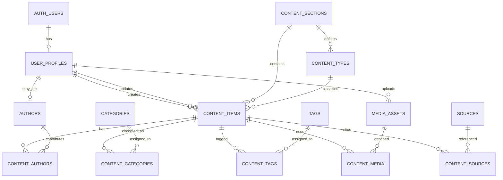

# SAS Platform — Editorial Database Design v1

**Status:** Proposed design for review — no database migration has been created or applied.  
**Project:** `SAS_Platform`  
**Supabase project ref:** `budsfbyrdpjkobqstpyr`  
**Repository branch:** `feat/nextjs-foundation`  
**Decision date:** 2026-11-10

---

## 1. Purpose and scope

This document defines the first version of the editorial data model for the public SAS Media and Studies website.

The initial product scope contains four editorial sections:

1. News and current affairs.
2. Analysis and opinion.
3. Studies and research.
4. Programs and multimedia.

The following capabilities are explicitly out of scope for this first database version:

- Political files, issues, events, actors, and the wider knowledge graph.
- Interactive control maps and geospatial datasets.
- Paid researcher tools and subscriptions.
- A mandatory editorial review/approval stage.
- Advanced analytics, recommendations, and personalization.

The schema should leave room for those capabilities without creating their tables prematurely.

This is a design document only. It does not authorize SQL execution, storage-bucket creation, or changes to the hosted Supabase project.

## 2. Confirmed product decisions

| Decision | Selected option | Engineering interpretation |
|---|---|---|
| Content architecture | Unified | One central content record and shared publishing pipeline; related entities remain normalized in separate tables. |
| Publishing workflow | Simple | Draft, published, archived. No mandatory review state in v1. |
| Authors | Hybrid | An author can be an internal account-linked contributor or an external person with no login account. |

### 2.1 Important distinction: unified does not mean one giant table

The unified model means that all editorial items share common identity, publication, URL, SEO, and ownership fields. It does not mean that categories, authors, media files, and citations should be stored as repeated text or JSON inside the content row.

Use relational tables for entities and many-to-many relationships. Use JSONB only for the structured body document and genuinely flexible metadata.

## 3. Core modeling principles

1. **One editorial lifecycle:** all four sections use the same create, edit, publish, archive, and public-display rules.
2. **Separate section, content type, and presentation format:**
   - Section answers where the item belongs on the site.
   - Content type answers what editorial kind of item it is.
   - Presentation format answers how it is delivered (text, video, audio, gallery, or mixed).
3. **Authors are not login accounts:** external authors must be representable without creating Supabase Auth users.
4. **Files are not database blobs:** Supabase Storage holds binary assets; PostgreSQL holds metadata and relationships.
5. **Public content is explicitly published:** anonymous visitors must never receive drafts or archived content through the public API.
6. **UTC timestamps:** store timestamps as `timestamptz`; render them in the website's chosen timezone.
7. **Stable public URLs:** every content item has a unique slug; changing a published slug should be a controlled editorial action with a future redirect capability.
8. **No destructive cleanup by default:** archive editorial records instead of deleting them.

## 4. Proposed entity relationship model

The diagram describes the intended relationships. It is conceptual and is not SQL.

## 5. Proposed tables

### 5.1 `user_profiles` — internal application users

One profile per Supabase Auth user. This table is for people who can sign in to the editorial administration area; it is not the public author directory.

Proposed fields:

| Field | Type / rule | Purpose |
|---|---|---|
| `id` | UUID, PK, FK to `auth.users.id` | Auth identity |
| `display_name` | text, required | Name shown in administration |
| `role` | text, constrained | `admin`, `editor`, or `author` |
| `is_active` | boolean, default true | Disable application access without deleting Auth identity |
| `created_at`, `updated_at` | timestamptz | Audit timestamps |

V1 uses one primary role per user to keep administration simple. If the team later needs multiple simultaneous roles or fine-grained permissions, introduce a role-grant model in a later migration.

Do not expose `auth.users` directly to the browser.

### 5.2 `content_sections` — the four public sections

Seed exactly these initial sections:

| Slug | Arabic title |
|---|---|
| `news` | الأخبار والشؤون الجارية |
| `analysis-opinion` | التحليل والرأي |
| `research` | الدراسات والأبحاث |
| `programs-media` | البرامج والوسائط المتعددة |

Proposed fields: `id`, `slug` (unique), `title_ar`, optional `title_en`, `description`, `sort_order`, `is_active`, `created_at`.

These are top-level editorial destinations, not subject categories.

### 5.3 `content_types` — editorial item types

A controlled list of types, each associated with one section. Initial candidates:

- News item.
- Analysis article.
- Opinion article.
- Research paper.
- Research report.
- Program.
- Program episode.
- Interview.
- Podcast episode.

Proposed fields: `id`, `section_id` (FK), `slug`, `title_ar`, optional `title_en`, `description`, `is_active`, `sort_order`.

The final seed list should be checked against the actual products SAS intends to publish before the first migration. Avoid creating a separate content table for each type.

### 5.4 `content_items` — central editorial record

This is the core table. Every news item, article, study, or media item receives one record.

| Field | Type / rule | Purpose |
|---|---|---|
| `id` | UUID, PK | Stable content identifier |
| `section_id` | FK, required | One of the four site sections |
| `content_type_id` | FK, required | Editorial type |
| `presentation_format` | constrained text | `text`, `video`, `audio`, `gallery`, `mixed` |
| `language_code` | text, default `ar` | Main language of this item |
| `title` | text, required | Public headline |
| `slug` | text, required, globally unique | Stable URL segment |
| `subtitle` | text, nullable | Optional secondary headline |
| `excerpt` | text, nullable | Listing and social summary |
| `body` | JSONB | Structured rich-text document |
| `body_schema_version` | smallint, default 1 | Version of the body document format |
| `status` | constrained text | `draft`, `published`, `archived` |
| `is_featured` | boolean, default false | Editorial highlighting |
| `published_at` | timestamptz, nullable | Publication time |
| `archived_at` | timestamptz, nullable | Archive time |
| `created_by` | FK to `user_profiles.id`, nullable on deletion | Creating user |
| `updated_by` | FK to `user_profiles.id`, nullable on deletion | Last editing user |
| `published_by` | FK to `user_profiles.id`, nullable | User who published |
| `seo_title` | text, nullable | Search title override |
| `seo_description` | text, nullable | Search description |
| `canonical_url` | text, nullable | Canonical URL override |
| `created_at`, `updated_at` | timestamptz | Record timestamps |

Rules:

- A published item must have a non-null `published_at`.
- Drafts and archived items are excluded from anonymous public reads.
- Slugs are unique across the entire site, not merely within a section.
- `body` should use a documented structured JSON format compatible with the selected editor (for example, TipTap JSON); do not store arbitrary unsanitized HTML as the canonical body.
- Validate body nodes, embedded URLs, and media references in the application layer.
- Do not put view counts or analytics counters on this row in v1.
- A content type must belong to the same section as the content item; enforce this with a database-safe design (for example, a composite foreign key) rather than relying only on the UI.

### 5.5 `authors` and `content_authors` — hybrid author directory

`authors` is the public-facing author identity. It is independent of authentication.

Proposed `authors` fields:

- `id` UUID PK.
- `user_profile_id` nullable unique FK to `user_profiles.id`.
- `display_name` required.
- `slug` unique.
- `bio` nullable.
- `job_title` nullable.
- `organization` nullable.
- `avatar_media_id` nullable FK to `media_assets.id` (add after media table creation).
- `is_active` boolean.
- `created_at`, `updated_at`.

Interpretation:

- Internal author: has a linked `user_profile_id`.
- External author: `user_profile_id` is null.
- An external author does not need an Auth account or dashboard access.

`content_authors` joins content and authors:

- `content_id` FK.
- `author_id` FK.
- `contribution_role` (for example author, researcher, interviewer, presenter).
- `sort_order` integer.
- Composite primary key on (`content_id`, `author_id`).

This supports multiple contributors and a stable display order.

### 5.6 `categories` and `content_categories` — subject classification

Categories describe subjects, not site sections. A category may have a parent category.

Proposed `categories` fields:

- `id` UUID PK.
- `parent_id` nullable self-FK.
- `slug` unique.
- `title_ar` required; optional `title_en`.
- `description` nullable.
- `sort_order`, `is_active`, timestamps.

`content_categories` is a many-to-many join with composite key (`content_id`, `category_id`). A content item may have multiple subject categories.

### 5.7 `tags` and `content_tags` — lightweight labels

Tags provide more granular labels than categories.

Proposed `tags` fields: `id`, `slug` unique, `name_ar`, optional `name_en`, `is_active`, timestamps.

`content_tags` is a many-to-many join with composite key (`content_id`, `tag_id`).

Avoid creating a tag for every named entity in v1; a future knowledge graph should model entities explicitly.

### 5.8 `media_assets` and `content_media` — media library

Binary files belong in Supabase Storage, not PostgreSQL.

Proposed `media_assets` fields:

- `id` UUID PK.
- `storage_bucket` text.
- `object_path` text.
- `original_filename` text.
- `mime_type` text.
- `size_bytes` bigint.
- `width`, `height` nullable integers.
- `alt_text`, `caption`, `credit` nullable.
- `uploaded_by` nullable FK to `user_profiles.id`.
- `created_at`.

Add a unique constraint on (`storage_bucket`, `object_path`).

`content_media` links assets to content:

- `content_id` FK.
- `media_asset_id` FK.
- `usage`: `cover`, `gallery`, `inline`, `attachment`, `audio`, or `video`.
- `position` integer.
- Composite key or unique constraint to prevent duplicate links.
- A partial unique index should allow at most one cover asset per content item.

Storage policy decision required before implementation:

- Publicly readable buckets must contain only assets intended for public distribution. A public bucket makes its objects retrievable by URL even if the associated content is still a draft.
- Upload, update, and delete permissions must be limited to authenticated editorial users.
- Confidential or unpublished private documents must not be placed in a public bucket.
- Decide whether v1 uses a public `site-media` bucket for publication-ready images, a private bucket with controlled delivery, or both. Do not create buckets until this is approved.

### 5.9 `sources` and `content_sources` — attribution and references

A source is an outlet, institution, document publisher, or reference location. It is not a political actor record.

Proposed `sources` fields:

- `id` UUID PK.
- `name` required.
- `source_type` constrained text (for example news outlet, official institution, research organization, document).
- `url` nullable.
- `organization` nullable.
- `language_code` nullable.
- `created_at`, `updated_at`.

`content_sources` joins content to sources and may hold a specific `reference_url`, `citation_label`, `note`, `source_published_at`, `accessed_at`, and `sort_order`.

This supports attribution and source links without claiming to be a full source-reliability assessment system.

## 6. Relationships and cardinality

- One section has many content types and many content items.
- One content type belongs to one section and has many content items.
- One content item has one section and one content type.
- Content and authors are many-to-many.
- Content and categories are many-to-many.
- Content and tags are many-to-many.
- Content and media assets are many-to-many.
- Content and sources are many-to-many.
- One Auth user may have one user profile.
- One author may optionally link to one internal user profile; external authors have no link.

## 7. Roles and simplified publishing workflow

V1 roles:

| Role | Create drafts | Edit own drafts | Edit others' content | Publish / archive | Manage users and settings |
|---|---:|---:|---:|---:|---:|
| `admin` | Yes | Yes | Yes | Yes | Yes |
| `editor` | Yes | Yes | Yes | Yes | No |
| `author` | Yes | Yes | No | No | No |

Rules:

- Authors can create and edit their own drafts.
- Editors and administrators can edit and publish content.
- Publishing is a direct action; no mandatory `in_review` state is used in v1.
- Only active internal users with the appropriate role can access editorial operations.
- External author records do not grant login or editorial permissions.
- Public visitors can read only published content and its public related metadata.

These rules must be enforced by Supabase Row Level Security (RLS), not only by hiding buttons in the Next.js interface.

Implementation should use carefully reviewed helper functions/policies to avoid recursive RLS checks. Never expose a Supabase service-role/secret key in browser code.

## 8. Public read and private write security model

### Anonymous/public access

Allow read access only to:

- Published content.
- Active sections, content types, categories, tags, and author profiles associated with published material.
- Media metadata and objects approved for public distribution.
- Source attribution intended for display.

Do not expose:

- Draft or archived content.
- User profiles, private account details, or internal roles.
- Private storage objects.
- Editorial audit information.

### Authenticated editorial access

- `author`: insert content with `created_by = auth.uid()`; update only own draft records.
- `editor`: manage editorial content and publication status.
- `admin`: manage content and application users/settings.
- Validate ownership and role server-side and in RLS.

A profile bootstrap mechanism must be designed safely. Do not allow a user to set their own role to `admin` by editing their profile.

## 9. Indexes and database behavior

Initial indexes to plan:

- Unique index on `content_items.slug`.
- Composite index on (`status`, `published_at DESC`).
- Composite index on (`section_id`, `status`, `published_at DESC`).
- Indexes on all foreign keys used in joins and policies.
- Unique indexes on section/type/category/tag/author slugs.
- Indexes on join-table foreign keys.
- Unique (`storage_bucket`, `object_path`) for media assets.
- Partial unique index for one cover image per content item.

Database behavior:

- Use `timestamptz` and UTC storage.
- Use UUID primary keys.
- Add a consistent `updated_at` trigger where needed.
- Use foreign-key delete behavior deliberately; avoid cascading deletion of published content or shared authors/media.
- Archive content rather than hard-delete it.
- Add full-text search only after the chosen Arabic search strategy is tested; do not assume PostgreSQL's default text search configuration is sufficient for Arabic.

## 10. Storage and image handling

The database stores object paths and metadata; the file bytes remain in Storage.

For the public website:

- Prefer optimized WebP/AVIF derivatives for display.
- Preserve a suitable original when editorial/legal requirements require it.
- Store alt text, caption, and credit separately from the binary file.
- Define upload size limits and accepted MIME types before enabling uploads.
- Do not use the database as a file store.
- Do not place confidential documents in publicly readable buckets.

Storage bucket creation and Storage RLS are separate implementation decisions and must be included in reviewed migrations or documented provisioning steps.

## 11. Explicitly deferred tables and capabilities

Do not create these in the first schema migration:

- Political issues, events, actors, organizations, and relationship graph.
- Geographic control areas and map layers.
- Subscriptions, billing, and paid access.
- Comments, reactions, and user-generated discussion.
- Newsletter campaigns.
- Analytics event streams and detailed visitor tracking.
- Mandatory editorial review queues.
- Full revision snapshots and advanced audit-log infrastructure.
- Translation groups and linked multilingual editions.

The model includes `language_code` for each content item, but a complete translation workflow is deferred.

## 12. Proposed migration plan (not yet created)

After this document is reviewed and approved, implement the schema in small, reviewable migrations:

1. **Core identities and taxonomy foundations:** user profiles, sections, content types, authors, and central content table.
2. **Editorial relationships:** content authors, categories, tags, and join tables.
3. **Media and source attribution:** media assets, content-media links, sources, and content-source links.
4. **Security and operational rules:** indexes, timestamp triggers, constraints, RLS policies, and carefully scoped grants.
5. **Seed data:** the four initial sections and the approved initial content-type list.

The exact ordering may be adjusted to resolve foreign-key dependencies. Each migration must be tested locally before any remote application.

## 13. Decisions still required before the first migration

The following points are intentionally left open rather than silently assumed:

1. **Media bucket exposure:** public bucket, private bucket with controlled delivery, or a split model.
2. **Content body editor:** confirm TipTap JSON or select another editor and document its JSON schema.
3. **Initial content-type list:** approve the exact types and their section mappings.
4. **Public language strategy:** Arabic-first with optional English items, or Arabic-only for the initial release.
5. **Internal account bootstrap:** decide who can create the first administrator and how additional users are invited.
6. **Slug policy:** define whether published slugs may be edited and whether redirects are required at launch.
7. **Deletion policy:** confirm archive-only for published content and who may permanently delete drafts.

## 14. Approval gate

No migration should be created or applied until:

- The product owner reviews this document.
- Open decisions affecting schema/security are resolved.
- Table relationships, constraints, indexes, and RLS rules are reviewed.
- The migration plan is reflected in GitHub.
- The local Supabase environment is available for migration testing.

**Current state:** design proposal only. The hosted database remains unchanged.
